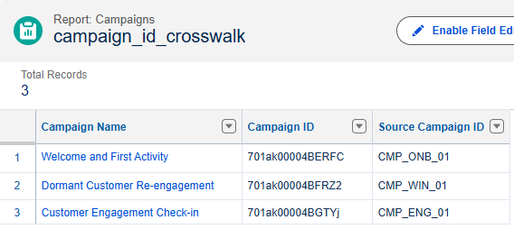
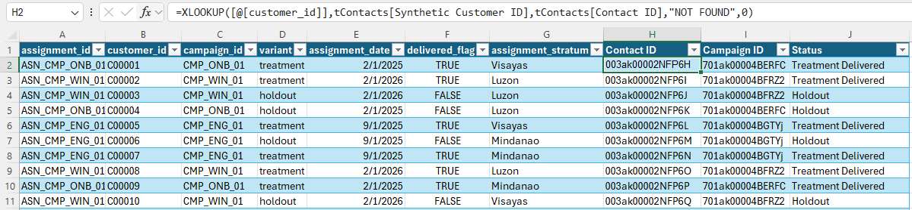
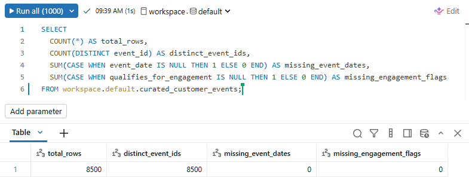
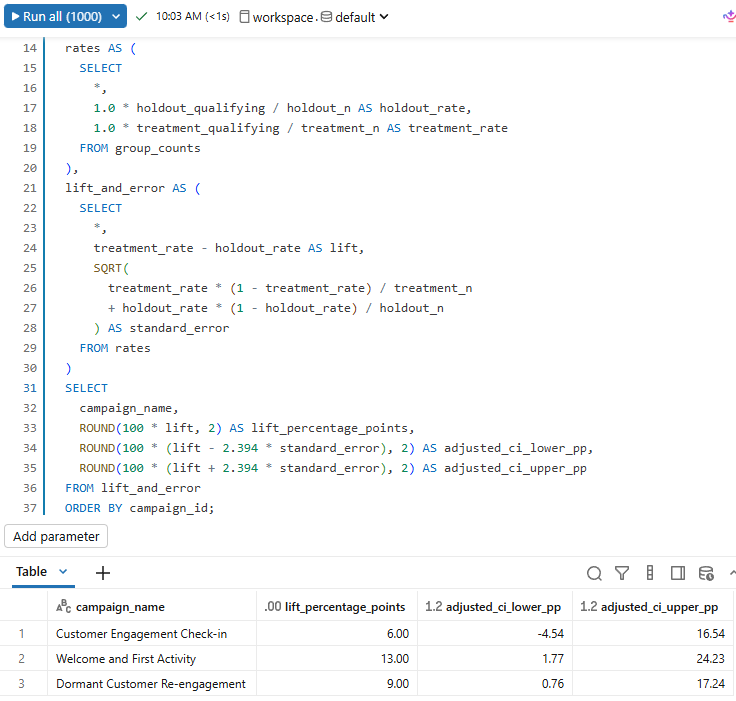
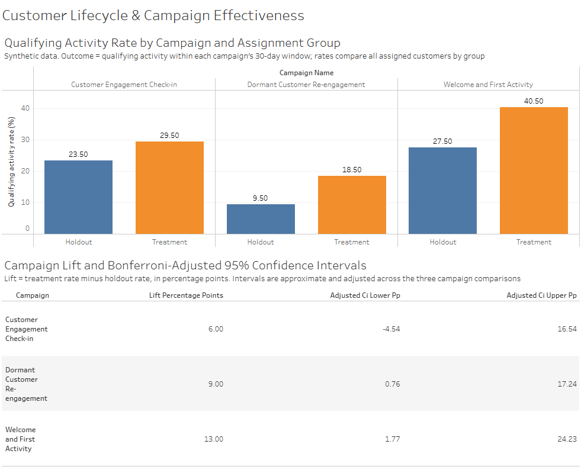
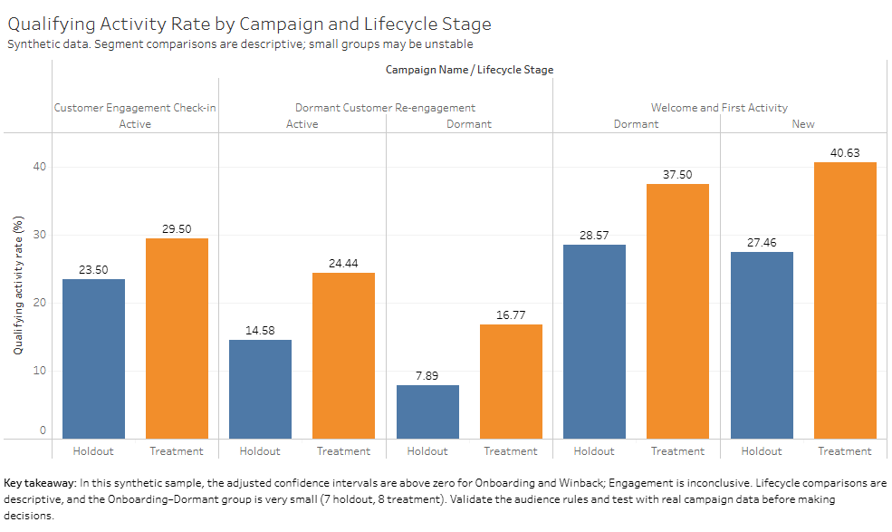

# Customer Lifecycle & Campaign Effectiveness — Case Study

> This project uses synthetic data. Its results demonstrate an analysis workflow and do not predict real campaign performance.

## At a Glance

- **Business question:** How did qualifying-activity rates compare between Treatment and Holdout customers across the three synthetic campaigns?
- **Outcome measured:** Whether a customer completed at least one qualifying activity within 30 days after campaign assignment.
- **Data and tools:** Synthetic customer, campaign, assignment, and activity-event data; Salesforce, Excel, Databricks SQL, Tableau Public, and AI-assisted query development.
- **Deliverables:** [View the Tableau dashboard](https://public.tableau.com/app/profile/rodolfo.flores4240/viz/CustomerLifecycleCampaignEffectiveness/CustomerLifecycleCampaignEffectiveness) · [View the project repository](https://github.com/RodolfoFlores27/customer-lifecycle-campaign-effectiveness)

## Project Context and My Role

This was a guided portfolio project using synthetic data. I configured the Salesforce campaigns and imported the synthetic records, mapped customer and campaign IDs in Excel, loaded and checked the CSVs in Databricks, and used Databricks SQL—with AI assistance—to prepare and verify the campaign and lifecycle summaries. I built and published the Tableau Public dashboard, then checked its values against the analysis outputs. I used guidance and AI assistance to interpret the results and refine the case study; the data does not establish how real campaigns would perform or prove causal impact.

## Workflow

### 1. Define the Question and Outcome

- **Goal:** Compare the treatment and holdout qualifying-activity rates within each of the three campaigns.
- **What I did:** A customer qualifies if they had at least one `account_login`, `repeat_account_use`, or `self_service_action` event within 30 days after assignment.
- **Key decision or check:** Use all assigned customers in each group as the denominator, including customers with no qualifying event.
- **Output:** A qualifying-activity rate for each group and the treatment-minus-holdout difference for each campaign.

### 2. Configure the CRM Workflow in Salesforce

- **Goal:** Represent the synthetic customers, campaigns, and campaign assignments in Salesforce.
- **What I did:** Imported 1,200 Contacts, configured three Campaigns, and imported 1,200 Campaign Members with the project’s Holdout, Treatment Delivered, and Treatment Not Delivered statuses.
- **Key decision or check:** The contact, campaign, campaign member, and status totals matched the expected counts.
- **Output:** Each campaign had 400 members, split between 200 Holdout and 200 Treatment assignments.

### 3. Map Records in Excel

- **Goal:** Match synthetic customer and campaign assignments to the corresponding Salesforce records.
- **What I did:** Used the Salesforce Contact and Campaign ID exports with `AssignmentsContactsCampaigns.xlsx` to map the assignments and prepare the Campaign Member import CSV.
- **Key decision or check:** Confirmed the lookups and mapping checks matched the expected records.
- **Output:** A mapped CSV ready for the Salesforce Campaign Member import.
- **Evidence image and caption:**

#### Salesforce Campaign ID mapping

*The Salesforce report provided the Campaign ID mappings used to prepare the assignment import.*

#### Excel customer ID mapping

*XLOOKUP matched synthetic customer IDs to Salesforce Contact IDs; the campaign mappings and statuses were used to prepare the Campaign Member import.*

### 4. Load and Validate Data in Databricks

- **Goal:** Make sure the source tables were complete and consistent before analyzing them.
- **What I did:** Loaded the original synthetic customer, campaign, assignment, and event CSVs into Databricks and created tables. These CSVs were loaded separately from Salesforce; they were not Salesforce exports.
- **Key decision or check:** Checked expected row counts and relationships, compared campaign metadata with Salesforce, and inspected duplicate event IDs. After removing one exact duplicate, the event table had 8,500 rows and 8,500 distinct event IDs.
- **Output:** Validated tables ready for analysis.
- **Evidence image and caption:**

#### Databricks event data validation

*The check returned 8,500 rows and 8,500 distinct event IDs, with no missing event dates or engagement flags.*

### 5. Analyze Campaign Results with SQL

- **Goal:** Compare qualifying-activity rates between Holdout and Treatment for each campaign.
- **What I did:** In Databricks SQL, joined assignments to activity events, counted qualifying events within 30 days after assignment, and calculated group rates and treatment-minus-holdout lift. I also calculated approximate Bonferroni-adjusted 95% confidence intervals for the three campaign comparisons and prepared lifecycle-segment summaries.
- **Key decision or check:** Used the defined qualifying event types and all assigned customers as each group’s denominator. Checked the query outputs against the expected results. The assignments were balanced but not genuinely randomized, so describe these as comparisons in synthetic data rather than proof of causal impact.
- **Output:** Campaign-level and lifecycle-segment summary tables, exported as CSVs for Tableau.
- **Evidence image and caption:**

#### Campaign lift and confidence intervals

*The query compared treatment and holdout qualifying activity rates and calculated campaign lift with Bonferroni-adjusted confidence intervals.*

### 6. Present the Results in Tableau

- **Goal:** Present the campaign comparisons and lifecycle breakdown in a clear dashboard.
- **What I did:** Imported the campaign-level and lifecycle-segment summary CSVs into Tableau Public. Built views for Holdout versus Treatment activity rates by campaign, campaign lift with adjusted confidence intervals, and activity rates by campaign and lifecycle stage. Combined them into the dashboard and published it to Tableau Public.
- **Key decision or check:** Verified the chart values, number formats, and tooltips against the Databricks summaries; checked that the published dashboard opens publicly.
- **Output:** The public Tableau dashboard: https://public.tableau.com/app/profile/rodolfo.flores4240/viz/CustomerLifecycleCampaignEffectiveness/CustomerLifecycleCampaignEffectiveness
- **Evidence image and caption:**

#### Overall campaign results

*The dashboard summarizes qualifying activity rates for treatment and holdout groups and shows the estimated lift and adjusted confidence intervals.*

#### Results by campaign and lifecycle stage

*Lifecycle-stage results are descriptive; the dormant onboarding group is especially small.*

## Findings

- **Customer Engagement Check-in:** Treatment was 29.50% versus 23.50% for Holdout, a 6 percentage-point difference. Its adjusted interval (−4.54 to +16.54 points) includes zero, so the result is inconclusive.
- **Welcome and First Activity:** Treatment was 40.50% versus 27.50%, a 13-point difference. Its adjusted interval (+1.77 to +24.23 points) is above zero in this simulation.
- **Dormant Customer Re-engagement:** Treatment was 18.50% versus 9.50%, a 9-point difference. Its adjusted interval (+0.76 to +17.24 points) is above zero, though its lower bound is close to zero.
- **Lifecycle breakdown:** The Onboarding–Dormant segment had only 7 Holdout and 8 Treatment customers, so its rates are especially uncertain. In the Winback campaign, 93 of 400 assigned customers were classified as Active under the project’s definitions.

## Limitations

- The customer records and outcomes are synthetic; they do not show how real customers or campaigns would behave.
- Treatment and Holdout groups were balanced, but not genuinely randomized. Within each synthetic campaign group, sorted customer IDs were alternated between them, so the differences do not establish campaign causation.
- The exact treatment—such as the message or offer—was not specified.
- Lifecycle stages use project-defined rules. The Onboarding–Dormant segment had only 7 Holdout and 8 Treatment customers, so its rates are especially uncertain; lifecycle comparisons are descriptive.
- The campaign confidence intervals are approximate and Bonferroni-adjusted across the three campaign comparisons.

## Recommended Next Step

These results suggest questions to test with real campaign data, rather than immediate decisions about campaign performance.
- **Customer Engagement Check-in:** Treatment was 6 percentage points higher, but the adjusted interval includes zero. Define the exact message or offer, then run a properly randomized test with enough customers to judge whether it makes a meaningful difference.
- **Dormant Customer Re-engagement:** 93 of the 400 assigned customers were classified as Active under the project’s rules. Review the audience criteria and consider testing the campaign with a dormant-only audience. This synthetic result does not prove that contacting Active customers wastes resources.
Validate these ideas with real campaign data before making operational decisions.

## Interview Walkthrough

Use the workflow headings as your presentation order: question → process → checks and decisions → findings → limitations and next step.
